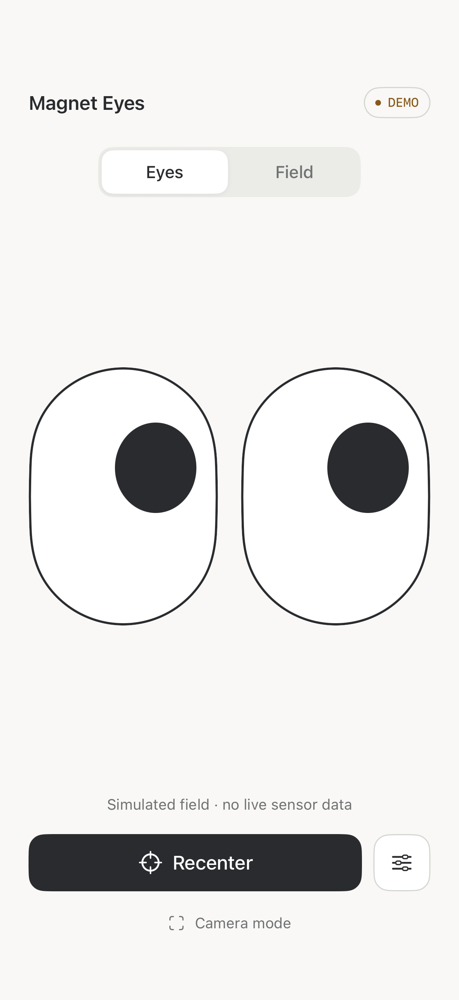
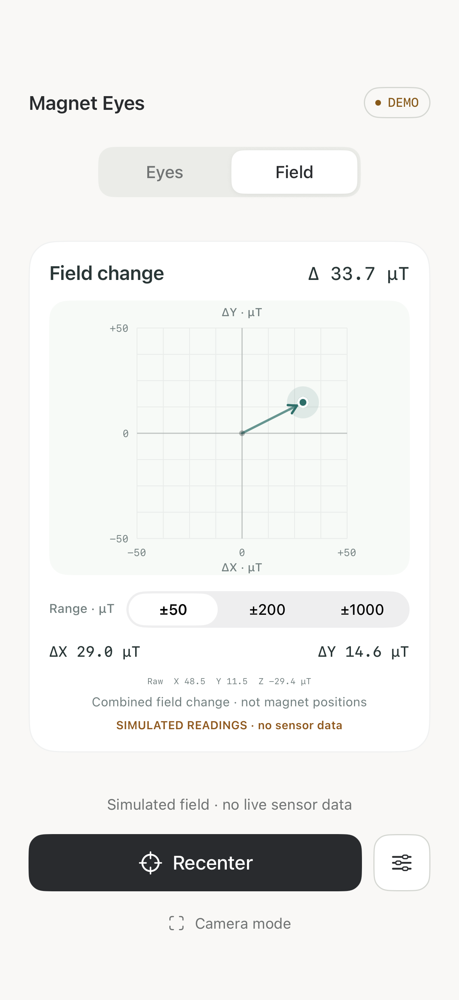

# Magnet Eyes

A small SwiftUI iPhone experiment that turns magnetic-field changes into animated eyes. Switch to **Field** to see the same response as a vector on a grid.

<p>
  
  
</p>

*Screenshots show the simulator’s explicitly labeled Demo mode.*

Built with SwiftUI and Apple’s Core Motion. No external dependencies, API keys, or network services. `MagnetEyesCore` is a local Swift package.

## Run it

You need Xcode with an iOS 17 or later SDK. A physical iPhone with a magnetometer is required for live readings.

1. Open `MagnetEyes.xcodeproj` and select the **MagnetEyes** scheme.
2. For a physical device, select your own development team under **Signing & Capabilities** and choose your iPhone. Use a unique bundle identifier if your signing setup requires one.
3. Run the app. It starts in **Live sensor** mode. Allow Motion access if iOS requests it.
4. Place the phone on a nonmagnetic support, remove the magnet and magnetic phone accessories, and tap **Recenter**. Keep it still for about one second while the baseline is captured.
5. Bring a small, weak fridge magnet nearby and move it slowly, keeping the same face and orientation toward the phone. Avoid powerful magnets and magnetic phone accessories.

The simulator has no magnetometer. It shows **NO SENSOR** until you explicitly select **Try demo** or **Field controls → Demo**. You can also use the `--demo` launch argument for simulator previews. Remove that argument before testing live readings. Demo is never silently substituted for the sensor.

## Controls

| Control | Behavior |
| --- | --- |
| **Eyes / Field** | Switch between the character and the measured field-change plot. |
| **Recenter** | Capture a fixed ambient-field baseline with the phone still and magnet removed. |
| **Field range** | Set the grid to ±50, ±200, or ±1000 µT. An out-of-range marker is clipped and labeled; numeric values remain unchanged. |
| **Field axes** | Select X/Y, X/Z, or Y/Z for the eyes and grid. |
| **Sensitivity / inversion** | Tune the eyes’ response. The grid retains measured signs and units. |
| **Show field readings** | Show raw X/Y/Z readings and the magnitude of the field change on the Eyes screen. |
| **Camera mode** | Hide controls for filming the selected view. It does not record video or access the camera. Demo disclosure stays visible. |

Updates stop while the app is inactive. Live mode requires a fresh baseline after resuming. Missing hardware, stale readings, and sensor errors produce a visible state instead of invented data.

## How it works

[`CMMotionManager`](https://developer.apple.com/documentation/coremotion/cmmotionmanager) delivers [`CMMagnetometerData`](https://developer.apple.com/documentation/coremotion/cmmagnetometerdata): a three-axis magnetic field in microteslas (µT).

1. Request samples at approximately 60 Hz; actual delivery depends on the device.
2. Smooth the field with a time-based low-pass filter (0.10-second time constant).
3. Subtract a stationary baseline: `ΔB = filtered B − baseline B`.
4. Map two selected components to the pupils, with a radial 1.5 µT deadzone and adjustable sensitivity.
5. Smooth the gaze (0.065-second time constant) and bound it inside the eyes. At 1× sensitivity, 40 µT beyond the deadzone reaches full travel.

Baseline capture averages about one second of samples and rejects unstable input. The baseline stays fixed until recentered, so a nearby stationary magnet is not gradually absorbed into it. Invalid and out-of-order samples are rejected.

The grid plots the selected components of `ΔB`, with positive vertical values upward. The total **Δ** reading is the magnitude of the full three-component change, `‖ΔB‖`, not the difference between field magnitudes. No marker appears before a valid baseline is ready.

## What this can—and cannot—show

A single magnetometer measures the **combined field at the phone**. It cannot count, separate, or locate individual magnets. Grid coordinates are field components, not positions in physical space. Rotating the phone also changes the readings.

The eyes use a field-change heuristic. A convincing “look toward the magnet” effect requires a stationary phone, a consistent magnet face/pole and orientation, tuned axes/inversions, and a short rehearsed path. Test both directions. Flipping the magnet or moving around the phone may reverse the response. Baseline subtraction alone cannot guarantee arbitrary magnet tracking; that needs additional spatial calibration, known geometry, or more sensing.

This is an independent exploration inspired by an online demo, not a claim to reproduce its implementation.

## Tests and validation

From the project directory:

```sh
swift test
xcodebuild -project MagnetEyes.xcodeproj -scheme MagnetEyes \
  -destination 'generic/platform=iOS Simulator' \
  -derivedDataPath /tmp/MagnetEyesDerivedData \
  CODE_SIGNING_ALLOWED=NO build
```

Run UI tests with **Product → Test** on an iPhone simulator. `project.yml` is an optional XcodeGen specification; the included Xcode project opens directly.

The core has **17 passing math tests** covering calibration, unstable and invalid inputs, fixed-baseline behavior, deadzone continuity, smoothing, axes, inversion, vector magnitude, bounds, and overflow protection. The light UI revision passed **3 simulator UI tests**, including unavailable hardware, explicit Demo, recentering, camera disclosure, the field marker, and clearing simulated state when returning to Live.

Simulator and physical-device builds passed. Build 2 was installed on an iPhone 17 Pro. **Physical magnet response remains unverified**; installation and simulator tests do not establish that the eyes reliably follow a real magnet. Local device receipts and build logs are excluded from this repository.

For a physical acceptance test, verify that recentering settles the eyes, moving the magnet changes the readings smoothly, holding it maintains the response, and removing it returns the eyes near center. Record the magnet orientation, path, axes, inversion, and sensitivity that produce a repeatable result.
